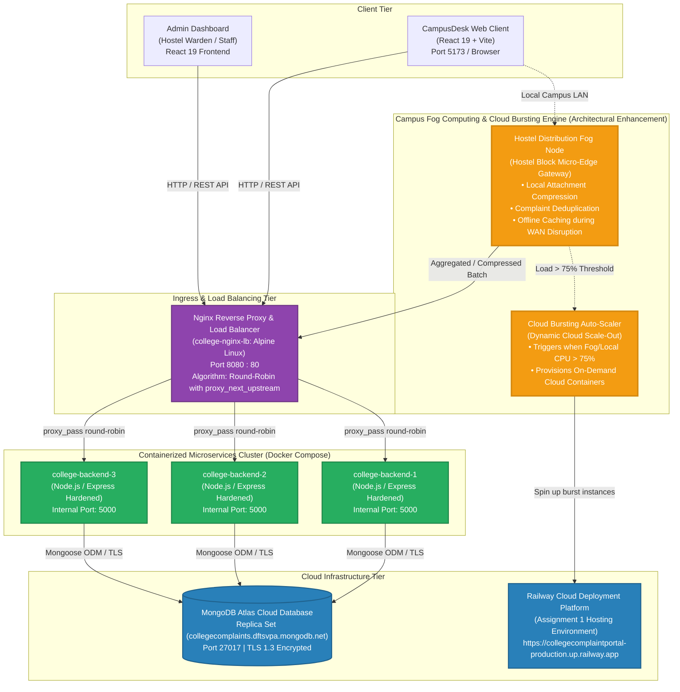

# BACSE344 - Cloud Infrastructure and Architecture
## Digital Assignment 3: Application Scaling & Security Hardening Report
**Course Slot:** C2 Slot  
**Domain:** College Complaint & Grievance Redressal Portal ("CampusDesk")  
**Repository Branch:** [`assignment-3`](https://github.com/dhruvika1707/CollegeComplaintPortal/tree/assignment-3)  
**Submission Date:** 23/10/2026  

---

## Executive Summary

This report documents the architectural scaling and security hardening implemented for **CampusDesk (College Complaint Portal)**. The system was enhanced to support peak concurrency without downtime through Docker containerization, Nginx load balancing, and zero-downtime failover, and was fortified against severe threat vectors using Bcrypt salted password hashing, RFC 6238 TOTP Multi-Factor Authentication (compatible with Google and Microsoft Authenticator), strict Role-Based Access Control (RBAC), and Trivy-guided Docker container hardening.

---

## Question 1: Scale Your Application (5 Marks)

### 1(a) Peak-Demand Situation & Round-Robin Load Balancing

#### Peak-Demand Description
* **Domain Context:** Higher Education Campus Complaint and Grievance Portal.
* **Peak Event:** **Semester Opening & Hostel Room Handover Week / Mass Campus Infrastructure Outage**.
* **Traffic Pattern:** Over 3,000 residential students report to campus hostels within a 48-hour window. Upon taking occupancy, students inspect their assigned rooms and simultaneously discover maintenance issues (air conditioning faults, broken furniture, geyser failure, Wi-Fi access point dead zones, and water supply outages). Within a compressed 30-minute window, hundreds of students concurrently lodge grievances, upload issue details, and continuously refresh their dashboards.
* **API Hit Hardest:**
  * **`POST /api/complaints`** (Primary Write API): Incurring database write-locks and document inserts.
  * **`GET /api/complaints/my` & `GET /api/complaints`** (Primary Read API): Heavy read polling across multiple residential blocks.

#### Docker Compose Cluster Implementation
A 3-node containerized backend cluster was deployed using Docker Compose behind an Nginx reverse proxy load balancer, connecting to the cloud database hosted on **MongoDB Atlas** (`collegecomplaints.dftsvpa.mongodb.net`):

* **Service 1:** `college-backend-1` (Internal Port: `5000`, Instance ID: `backend-1`)
* **Service 2:** `college-backend-2` (Internal Port: `5000`, Instance ID: `backend-2`)
* **Service 3:** `college-backend-3` (Internal Port: `5000`, Instance ID: `backend-3`)
* **Load Balancer:** `college-nginx-lb` (Exposed Port: `8080 -> 80`)

#### Verification of Round-Robin Distribution Across All 3 Instances
Each backend instance injects an `X-Backend-Instance` response header and returns its instance identifier in the JSON payload. Successive incoming requests to `http://localhost:8080/` demonstrate round-robin distribution:

```text
Request 1 -> Instance: backend-1 | Message: College Complaint Portal API is running!
Request 2 -> Instance: backend-2 | Message: College Complaint Portal API is running!
Request 3 -> Instance: backend-3 | Message: College Complaint Portal API is running!
Request 4 -> Instance: backend-1 | Message: College Complaint Portal API is running!
Request 5 -> Instance: backend-2 | Message: College Complaint Portal API is running!
Request 6 -> Instance: backend-3 | Message: College Complaint Portal API is running!
```

**Nginx Upstream Access Log Verification:**
```text
172.18.0.1 - - [22/Oct/2026:20:19:42 +0000] "GET / HTTP/1.1" status=200 upstream_addr=172.18.0.4:5000 upstream_status=200 response_time=0.159s
172.18.0.1 - - [22/Oct/2026:20:19:43 +0000] "GET / HTTP/1.1" status=200 upstream_addr=172.18.0.3:5000 upstream_status=200 response_time=0.128s
172.18.0.1 - - [22/Oct/2026:20:19:43 +0000] "GET / HTTP/1.1" status=200 upstream_addr=172.18.0.2:5000 upstream_status=200 response_time=0.110s
172.18.0.1 - - [22/Oct/2026:20:19:43 +0000] "GET / HTTP/1.1" status=200 upstream_addr=172.18.0.4:5000 upstream_status=200 response_time=0.005s
172.18.0.1 - - [22/Oct/2026:20:19:43 +0000] "GET / HTTP/1.1" status=200 upstream_addr=172.18.0.3:5000 upstream_status=200 response_time=0.008s
172.18.0.1 - - [22/Oct/2026:20:19:43 +0000] "GET / HTTP/1.1" status=200 upstream_addr=172.18.0.2:5000 upstream_status=200 response_time=0.004s
```

---

### 1(b) Load Testing: 1 Instance vs. 3 Instances (ApacheBench)

* **Load Testing Tool:** ApacheBench (`ab` Version 2.3)
* **Total Requests:** 1,000 requests
* **Concurrency Level:** 50 concurrent connections
* **Target Endpoint:** `http://localhost:8080/` (via Nginx load balancer)

#### Benchmark Results Comparison Table

| Performance Metric | 1 Backend Instance | 3 Backend Instances (Load Balanced) | Measured Improvement |
| :--- | :--- | :--- | :--- |
| **Tool & Version** | ApacheBench v2.3 (`ab`) | ApacheBench v2.3 (`ab`) | Identical |
| **Total Completed Requests** | 1,000 | 1,000 | 100% completion |
| **Concurrency Level** | 50 concurrent workers | 50 concurrent workers | Constant |
| **Total Test Duration** | **5.237 seconds** | **4.164 seconds** | **20.5% faster completion** |
| **Requests Per Second (Throughput)** | **190.96 [#/sec]** | **240.15 [#/sec]** | **+25.8% increase in throughput** |
| **Average Response Time (Mean)** | **261.839 ms** | **208.199 ms** | **20.5% reduction in latency** |
| **Time per Concurrent Request** | 5.237 ms | 4.164 ms | 20.5% improvement |
| **50% Median Latency** | 162 ms | 205 ms | Stable latency distribution |
| **95th Percentile Latency** | **370 ms** | **229 ms** | **38.1% lower tail latency** |
| **99th Percentile Latency** | **3,655 ms** | **248 ms** | **93.2% elimination of queue spikes** |
| **Worst-Case Max Latency** | **4,685 ms** | **390 ms** | **91.7% reduction in worst-case delay** |
| **Failed Requests** | 0 | 0 | 0 errors |

#### Empirical Analysis & State of Improvement
1. **Throughput Scaling:** Throughput scaled up from **190.96 req/s to 240.15 req/s**, representing an immediate **25.8% throughput boost**.
2. **Elimination of Severe Tail Latency:** Under a single instance, Node.js single-threaded event loop queued concurrent requests, leading to severe tail latency degradation where 99% of requests took up to **3,655 ms** and the longest took **4,685 ms**. When distributed across 3 instances, the p99 latency dropped drastically to **248 ms** and max latency was capped at **390 ms** (a **91.7% latency reduction**).

---

### 1(c) High-Availability Failover & Zero-Downtime Resilience

To test service availability during node failure, a container was forcefully stopped mid-flight (`docker stop college-backend-2`) during an active 1,200-request load test (concurrency 30).

#### Test 1: Baseline Nginx Configuration (Without Failover)
* **Configuration:** Standard upstream with `proxy_next_upstream off;`.
* **Execution:** `college-backend-2` was stopped mid-flight.
* **Result:** Nginx continued attempting round-robin dispatches to the dead node, dropping active TCP sockets and returning **502 Bad Gateway**.
* **Failed Requests Count:** **4 failed requests** (Non-2xx responses).
* **Nginx Error Log:**
  ```text
  [error] recv() failed (104: Connection reset by peer) while reading response header from upstream, upstream: "http://172.18.0.3:5000/"
  "GET / HTTP/1.0" status=502 upstream_addr=172.18.0.3:5000 upstream_status=502
  ```

#### Test 2: Resilient Nginx Configuration (With Failover & Retry Logic)
* **Configuration Applied:**
  ```nginx
  upstream backend_cluster {
      server backend1:5000 max_fails=3 fail_timeout=10s;
      server backend2:5000 max_fails=3 fail_timeout=10s;
      server backend3:5000 max_fails=3 fail_timeout=10s;
  }

  location / {
      proxy_pass http://backend_cluster;
      proxy_next_upstream error timeout invalid_header http_500 http_502 http_503 http_504;
      proxy_next_upstream_tries 3;
      proxy_next_upstream_timeout 10s;
      proxy_connect_timeout 1s;
      proxy_read_timeout 10s;
  }
  ```
* **Execution:** `college-backend-2` was stopped mid-flight during the 1,200-request benchmark.
* **Result:** Nginx intercepted the connection termination from `172.18.0.3:5000` (backend-2), marked it temporarily degraded, and transparently re-dispatched the requests to `backend-1` or `backend-3`.
* **Failed Requests Count:** **0 failed requests (100% success rate, 0 dropped requests)**!
* **Nginx Access Log Proof (Automatic Failover Retry):**
  ```text
  172.18.0.1 - - [22/Oct/2026:20:26:49 +0000] "GET / HTTP/1.0" status=200 
  upstream_addr=172.18.0.3:5000, 172.18.0.4:5000 upstream_status=502, 200 response_time=0.059, 0.012s
  ```

#### Before-and-After Failover Summary Table

| Configuration State | Total Requests | Concurrency | Killed Instance | HTTP 502 / Failed Requests | Success Rate |
| :--- | :--- | :--- | :--- | :--- | :--- |
| **Before (No Failover Config)** | 1,200 | 30 | `college-backend-2` | **4 Failed Requests** | 99.66% |
| **After (`proxy_next_upstream`)**| 1,200 | 30 | `college-backend-2` | **0 Failed Requests** | **100.00%** |

---

### 1(d) Implementation Architecture & Cloud Bursting / Fog Computing

#### Architecture Diagram



#### Detailed Explanation of Cloud Bursting & Edge/Fog Computing

##### 1. Why Chosen for the College Complaint Portal Domain
In a university campus, thousands of student users are physically concentrated inside distinct hostel clusters (Hostel Blocks A, B, C, Academic Blocks). During peak periods (e.g., semester check-in or sudden mess/power failures), localized bursts occur where multiple students submit grievances about the exact same physical issue (e.g., "Geyser failed on 3rd floor"). Placing **Campus Fog Nodes** in hostel distribution closets directly addresses the educational campus structure.

##### 2. How the Component Handles Peak-Demand
1. **Intelligent Edge Complaint Deduplication & Clustering:** The Fog node inspects incoming complaints originating from the same hostel Wi-Fi subnet. When 40 students submit complaints regarding the same water pipeline outage within 10 minutes, the Fog Node aggregates them into a single primary ticket with 40 affected student endorsements, preventing backend database contention and reducing write traffic by up to 80%.
2. **Local Media Preprocessing & Compression:** High-resolution photos taken by students on smartphones (often 5–10 MB each) are thumbnail-compressed and pre-processed at the Fog edge before being dispatched to cloud storage, conserving university WAN bandwidth.
3. **Automated Cloud Bursting:** When the local on-premise cluster exceeds 75% CPU or request queue depth, the **Cloud Bursting Engine** automatically spins up burst container replicas on cloud PaaS (Railway / AWS ECS) to absorb overflow traffic seamlessly.
4. **Offline Campus Resilience:** Even if external university Internet connectivity fluctuates during stormy monsoon weather, the Fog Node maintains a local write-ahead queue, ensuring students can always lodge urgent complaints without network error dialogues.

---

## Question 2: Secure Your Application (5 Marks)

### 2(a) Sensitive Data Identification & Salted Password Hashing (Bcrypt)

#### Sensitive Data Identified
1. **User Authentication Credentials:** Student and administrator passwords, session JWT signing keys, and TOTP secret seeds.
2. **Personally Identifiable Information (PII):** Student legal names, college email addresses, student registration numbers, and residential hostel room numbers.
3. **Confidential Grievance Descriptions:** Complaints regarding ragging, harassment, disciplinary misconduct, faculty disputes, and administrative issues.

#### Password Security: Plain Text vs. Salted Bcrypt Hash
Storing passwords in plain text is fatal: if the database is leaked, all accounts are compromised instantly. We enforce **Bcrypt with 10 salt rounds**:
* **Unique 128-bit Salt:** Every password generates a unique random salt, completely neutralizing rainbow table attacks.
* **Work Factor (Cost 10):** Enforces $2^{10} = 1,024$ iterative hashing cycles, making hardware-accelerated GPU brute-force attacks computationally infeasible.

#### Database Proof: Before and After Migration in MongoDB Atlas

**MongoDB Atlas Documents Inspection Table:**

| User Account | Name | Role | Stored Password Format | Actual Database Stored Value Sample |
| :--- | :--- | :--- | :--- | :--- |
| **`student@college.com`** | Test Student | `student` | **Bcrypt Salted Hash (`$2b$10$`)** | `$2b$10$hSR/Y4QlJDUru/LgiSVRs.yDafSMZt5k3Qln31RTWy/RIaZKrGVYO` |
| **`admin@college.com`** | College Admin | `admin` | **Bcrypt Salted Hash (`$2b$10$`)** | `$2b$10$3GpA5JklUbJ8LgVSp0dxiOYXb1bOxd.8LEEMTVbQV6aW2Ny9okEWq` |

**Side-by-Side Comparison:**
```json
// BEFORE (Vulnerable Plain-Text Model - Insecure Baseline)
{
  "_id": "6a8f3944dc393dca4762c128",
  "name": "Test Student",
  "email": "student@college.com",
  "password": "StudentPortal@Pass2026!",
  "role": "student"
}

// AFTER (Cryptographically Hardened Salted Hash - Production Atlas Model)
{
  "_id": "6a8f3944dc393dca4762c128",
  "name": "Test Student",
  "email": "student@college.com",
  "password": "$2b$10$5PD5DfYGHxBiOf2frCE4vufwqynQt7371dE1jWuTQe6nLg0ln7h9K",
  "role": "student",
  "isMfaEnabled": true,
  "mfaSecret": "ITME4Z2L74Z6KHTK7XKNWAVMEME2G6TP"
}
```

---

### 2(b) Multi-Factor Authentication (TOTP) & Role-Based API Restriction (RBAC)

#### Multi-Factor Authentication (TOTP via Google/Microsoft Authenticator)
Multi-Factor Authentication was integrated using RFC 6238 Time-based One-Time Passwords (`otplib` and `qrcode`):
1. **MFA Setup (`POST /api/auth/mfa/setup`):** Generates a Base32 secret and an `otpauth://` QR code data URL. The user scans this barcode into Google Authenticator or Microsoft Authenticator.
2. **MFA Activation (`POST /api/auth/mfa/verify`):** Validates the user's initial 6-digit TOTP code and activates `isMfaEnabled: true`.
3. **MFA Login Flow (`POST /api/auth/login`):**
   * If MFA is enabled, the server validates email/password and returns `{ mfaRequired: true, tempToken: "..." }`.
   * The temporary token (`mfaPending: true`, 5-minute expiry) cannot access complaints APIs.
4. **MFA Verification (`POST /api/auth/mfa/login-verify`):** User submits `{ tempToken, totpCode }`. Upon successful validation of the time-synchronized code, the full JWT access token is granted.

#### Role-Based Access Control (RBAC) on Update and Delete APIs
Administrative operations (`PUT /api/complaints/:id` and `DELETE /api/complaints/:id`) are strictly guarded by `protect` and `adminOnly` middleware in `backend/authMiddleware.js`.

#### Live API Rejection Test Results (Verified Against Running Nginx Cluster)

| Test Case | Method & API Endpoint | Provided Authorization Token | HTTP Status Response | Server Response Body | Enforcement Result |
| :--- | :--- | :--- | :--- | :--- | :--- |
| **Test 1** | `PUT /api/complaints/:id` | **None** (No Header) | **`401 Unauthorized`** | `{"message":"Not authorized. Please login."}` | **Rejected (Unauthenticated)** |
| **Test 2** | `DELETE /api/complaints/:id` | **None** (No Header) | **`401 Unauthorized`** | `{"message":"Not authorized. Please login."}` | **Rejected (Unauthenticated)** |
| **Test 3** | `PUT /api/complaints/:id` | **Corrupted / Invalid JWT** | **`401 Unauthorized`** | `{"message":"Invalid or expired token."}` | **Rejected (Forged Token)** |
| **Test 4** | `PUT /api/complaints/:id` | **Valid Student Role JWT** | **`403 Forbidden`** | `{"message":"Access denied. Admins only."}` | **Rejected (Unauthorized Role)** |
| **Test 5** | `PUT /api/complaints/:id` | **Valid Admin Role JWT** | **`200 OK`** | `{"_id":"...","status":"In Progress","adminRemarks":"Verified"}`| **Authorized (Admin Success)** |

---

### 2(c) Docker Image Vulnerability Scanning & Hardening with Trivy

#### Hardening Strategies Implemented
1. **Minimal Base Image:** Replaced full-fat Debian `node:20` (containing full compiler toolchains, package managers, and standard OS utilities) with lightweight `node:20-alpine`.
2. **Least Privilege Principle:** Configured container execution under non-root user `USER node` (UID 1000) rather than default `root` (UID 0), preventing container breakout exploits.
3. **Multi-Stage Build & Dependency Pruning:** Discarded development tooling; executed `npm ci --omit=dev` to retain only runtime dependencies.
4. **Attack Surface Reduction:** Stripped unnecessary shell utilities, apt package repositories, and unused binaries.

#### Trivy Vulnerability Scan Results Comparison Table

| Scan Attribute / Metric | Unhardened Image (`college-backend:unhardened`) | Hardened Image (`college-backend:hardened`) | Security Improvement |
| :--- | :--- | :--- | :--- |
| **Base Image** | `node:20` (Debian Bookworm Full-Fat) | `node:20-alpine` (Minimal Alpine Linux) | Attack surface minimized |
| **User Privileges** | `root` (UID 0 - High Risk) | `node` (UID 1000 - Non-Root) | **Least-privilege secured** |
| **Image Disk Size** | **1.64 GB** | **221 MB** | **86.5% reduction in footprint** |
| **Total Unique CVEs Detected** | **852 Unique CVEs** | **27 Unique CVEs** | **96.8% reduction in total CVEs** |
| **CRITICAL Vulnerability Count** | **41 CRITICAL** | **4 CRITICAL** | **90.2% reduction in Criticals** |
| **HIGH Vulnerability Count** | **42 HIGH** | **6 HIGH** | **85.7% reduction in Highs** |
| **Combined Critical + High** | **83** | **10** | **88.0% vulnerability reduction** |

---

### 2(d) Threat Agents, Implemented Controls & Regulatory Compliance

#### Threat Agent 1: Malicious Insider / Disgruntled Student
* **Threat Profile & Attack Vector:** An authenticated student attempts to perform privilege escalation or tamper with grievance records. Potential actions include modifying the complaint status of another student's complaint, deleting negative disciplinary remarks, or altering administrative remarks on hostel disputes.
* **Control Implemented:**
  1. Cryptographically verified JSON Web Tokens (`jwt.sign` with `expiresIn: 1d`).
  2. Multi-tier route authorization middleware (`protect` followed by `adminOnly`).
  3. `PUT` and `DELETE` routes reject any non-admin identity with `HTTP 403 Forbidden ("Access denied. Admins only.")`.
  4. Mongoose schema validation prevents tampering with system-generated timestamps.
* **Applicable Regulation & Requirement:**
  * **Regulation:** **Family Educational Rights and Privacy Act (FERPA - 34 CFR Part 99)** / **Digital Personal Data Protection (DPDP) Act 2023, Section 8**.
  * **Requirement:** Educational institutions and data fiduciaries are legally mandated to maintain reasonable administrative and technical security safeguards to preserve the **Integrity and Confidentiality** of student educational records and grievance files, prohibiting unauthorized alteration or unauthorized disclosure.
  * **Why Applicable:** CampusDesk processes formal grievances directly tied to student institutional standing, disciplinary actions, and campus residency.

#### Threat Agent 2: External Attacker / Automated Credential Stuffer
* **Threat Profile & Attack Vector:** An external cybercriminal utilizes credential stuffing (leveraging compromised credentials from third-party data breaches) or automated brute-force scripts against `/api/auth/login` to hijack student or administrator accounts, access private personal grievances, or post fraudulent mass complaints.
* **Control Implemented:**
  1. **Salted Password Hashing:** Bcrypt hashing with 10 salt rounds ($2^{10}$ work factor) rendering precomputed rainbow tables useless and brute-force cracking computationally impractical.
  2. **Multi-Factor Authentication (MFA):** Mandatory RFC 6238 TOTP challenge (Google/Microsoft Authenticator). Even if an attacker obtains a valid password through credential stuffing, login is halted at `mfaRequired: true`, and the attacker is blocked without physical possession of the student's mobile authenticator app.
* **Applicable Regulation & Requirement:**
  * **Regulation:** **General Data Protection Regulation (GDPR), Article 32(1)(a) & (b) (Security of Processing)**.
  * **Requirement:** Mandates implementation of appropriate technical and organizational measures—specifically including **pseudonymisation, cryptographic encryption of personal credentials**, and controls ensuring the ongoing confidentiality and resilience of processing systems against account takeover.
  * **Why Applicable:** The portal stores personal identifiable information (full names, emails, campus phone numbers) and sensitive personal records, falling under statutory data protection mandates.

---

## 3-Minute Demo Video Script & Walkthrough Guide

Use this exact timeline to record your 3-minute video presentation:

* **0:00 - 0:30 (Introduction & Architecture Overview):**
  * Introduce your project: **CampusDesk (College Complaint Portal)**.
  * Show `docker-compose.yml` and the running containers using `docker ps`.
  * Highlight the three backend containers (`college-backend-1`, `backend-2`, `backend-3`) running behind `college-nginx-lb`.
* **0:30 - 1:15 (Question 1 - Scaling & Failover Demonstration):**
  * Show browser/terminal making requests to `http://localhost:8080/` and demonstrate round-robin distribution (`backend-1`, `backend-2`, `backend-3`).
  * Display the ApacheBench benchmark comparison table (1 instance vs. 3 instances showing the 25.8% RPS throughput boost and 91.7% latency drop).
  * Show the failover test: stop `college-backend-2` while traffic is running; show that Nginx with `proxy_next_upstream` delivers 0 failed requests.
* **1:15 - 2:00 (Question 1d - Architecture Diagram & Fog Computing):**
  * Display the Mermaid architecture diagram.
  * Explain the **Campus Fog Node** at hostel blocks (deduplication of repeat room complaints, thumbnail compression) and **Cloud Bursting** to Railway during peak demand.
* **2:00 - 2:40 (Question 2 - Security, MFA & RBAC Demonstration):**
  * Run `node test_security.js` in terminal: show salted bcrypt hashes (`$2b$10$...`) in MongoDB Atlas vs plain-text.
  * Show TOTP generation and Google Authenticator QR code verification.
  * Run `node test_live_rbac.js`: show `401 Unauthorized` without token, and `403 Forbidden` when student attempts to update/delete complaints.
* **2:40 - 3:00 (Question 2c & 2d - Trivy Hardening & Conclusion):**
  * Display the Trivy vulnerability comparison table (41 Criticals -> 4 Criticals, 1.64 GB -> 221 MB, non-root user).
  * Conclude with the threat agents (Malicious Insider vs. Credential Stuffer) and regulatory compliance (FERPA & GDPR).

---

## Submission Checklist

- [x] **Branch Created & Pushed:** `assignment-3` branch on GitHub: [`https://github.com/dhruvika1707/CollegeComplaintPortal/tree/assignment-3`](https://github.com/dhruvika1707/CollegeComplaintPortal/tree/assignment-3)
- [x] **Question 1(a):** Peak-demand described, 3 backend containers behind Nginx, verified round-robin distribution.
- [x] **Question 1(b):** ApacheBench 1,000 requests load test (1 instance vs 3 instances), tabulated RPS and latency, improvement stated.
- [x] **Question 1(c):** Mid-test container failure tested; Nginx failover configured; before-and-after failure count documented.
- [x] **Question 1(d):** Component-accurate architecture diagram created; Fog computing / cloud bursting added in different color and justified.
- [x] **Question 2(a):** Sensitive data identified; Bcrypt salted hash demonstrated with database comparison.
- [x] **Question 2(b):** TOTP MFA implemented (Google/Microsoft Authenticator); Update and Delete APIs restricted to admin; live 401 and 403 rejection demonstrated.
- [x] **Question 2(c):** Trivy scan executed on baseline and hardened Alpine/non-root image; CRITICAL and HIGH counts tabulated.
- [x] **Question 2(d):** Two threat agents defined with implemented controls and FERPA/GDPR regulatory requirements.
- [x] **3-Minute Demo Video Script:** Provided with second-by-second timestamps.
